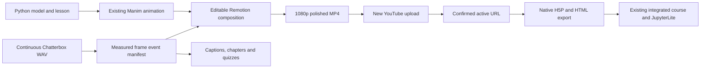

# Timing-preserving Remotion production

The existing validated Manim model, narrated timeline, native H5P and integrated Watch & Question page are retained. The feature branch adds a post-production layer, not a replacement physics engine.



## What is editable

`remotion/src/QuantumLecture.tsx` places the existing scientific animation inside the restrained navy/teal/amber design. `components/ScientificPanel.tsx` renders the Schrödinger and exact-transmission equations with local KaTeX typography. `components/Prediction.tsx` supplies seven non-leading prediction cards and measured reasoning holds. `Thumbnail.tsx` uses the actual Python wavefunction samples, rather than a decorative wave. `theme.ts` controls typography, colors and the Predict / Explain / Compute / Apply / Critique navigation.

The default composition is 1920×1080 at 30 fps. Baseline and polished editions are available in the same workspace. Existing source titles, narration order, scientific interpretations and independent numerical model are preserved. No stock music, cloned named lecturer, generative pseudo-wave or unlicensed image is introduced. Captions are separately uploadable, with optional burned captions for a tested alternative.

## One authoritative clock

`course/publication_events.json` is generated from `course/lesson.py`, `narration/timeline.json`, canonical quiz definitions in `scripts/author.py`, original subtitles and `course/narration_words.json`. The latter contains the existing local ASR timestamps needed to place visual emphasis near the spoken scientific term; it contains no model weights or voice recordings.

Events include scene boundaries, narration chunks, word-aligned emphasis, caption cues, chapter starts, each quiz and remediation target, prediction silence, answer-reveal boundaries, summary timing and the laboratory call to action. Frames are authoritative for editing. Captions retain measured millisecond timing, and YouTube chapter display times round to the nearest whole second. H5P and site chapters use the more precise targets.

`scripts/sync_publication.py` regenerates quiz JSON/CSV/Markdown, H5P authoring data, captions, chapters, YouTube description and website configuration. Its `--render` option probes the finished video and refuses a silent duration/frame-count change. The current edit is preserve mode: all seven quiz times and all scene boundaries must match the frozen baseline. A future recut needs a deliberately revised timing model and new verification; this implementation does not claim arbitrary automatic recuts.

`outputs/remotion-timing-report.json` distinguishes a prepared manifest from one checked against the finished render. `PREPARED_NOT_RENDER_VERIFIED` is not a successful full-render result.

## Scientific and educational checks

Default transmission and independently solved reflection are exported directly from `course/physics.py`. The doubled-width value comes from the same exact model. Boundary matching, constant current, convergence and limiting behavior remain covered by the existing tests. The notebook code is retained; students still vary parameters, compare the independent ODE calculation, examine synthetic evidence and address model limitations.

Misconception-specific feedback distinguishes classical turning points, continuity conditions, statistical counts, nonlinear width dependence, energy borrowing, STM ambiguity and non-unique experimental trends. Native H5P review jumps reset the question when a learner returns; standalone questions also retain their explicit Retry controls. This is formative practice, not proof of mastery or LMS gradebook submission.

## Audio and delivery

Delivery uses the original 48 kHz/24-bit mono WAV, with no new TTS generation. The Manim MP4 is muted. Chapter renders contain video only, so the continuous source audio is encoded exactly once at the final mux. This also avoids the +3 LUFS change observed when a mono source was duplicated to stereo by the sample renderer. Samples and final delivery therefore use the same direct master-audio mux.

The renderer explicitly selects BT.709 limited range to deliver `yuv420p`, rather than a full-range `yuvj420p` output. `scripts/verify_remotion.py` fully decodes the actual file and compares beginning/middle/end audio against the source WAV, checks one narration track, resolution, frame count, frame rate, codecs, loudness and true peak.

## Source and test provenance

Production began from main commit `76781c6a528b87ba80c38f2f2d9900f20b6b0a4f`. The source lives on `remotion-polish`; the live course keeps its original video until the new URL has been confirmed. Existing H5P.Video 1.6.81 and the same-origin chapter/resizing bridge are retained.

The source verification workflow runs physics/publication tests, TypeScript, manifest tests, desktop notebook execution, a feature-site build and the existing real-browser/Pyodide tests without deploying the branch. Full media rendering is local/manual because the masters are intentionally absent from GitHub. Real video/quiz playback is checked separately on a network that can stream YouTube; hosted-runner startup-only results are labelled accordingly.

## Testing the finished MP4 before YouTube upload

The public package keeps the confirmed active YouTube URL. An isolated, ignored preview can instead exercise the actual local polished MP4 with the same native H5P questions and Summary:

```sh
mkdir -p outputs/h5p-preview/h5p
cp outputs/Quantum_Tunneling_Lecture_Remotion.mp4 outputs/h5p-preview/h5p/polished.mp4
node webtools/h5p-build.cjs --preview-video-url http://127.0.0.1:8768/quantum-tunneling-course/h5p/polished.mp4
H5P_QA_DIRECTORY=outputs/h5p-preview node webtools/test-h5p-learning.cjs
H5P_QA_DIRECTORY=outputs/h5p-preview H5P_QA_PHONE=true node webtools/test-h5p-learning.cjs
```

On PowerShell, use `New-Item -ItemType Directory -Force`, `Copy-Item`, and `$env:H5P_QA_DIRECTORY='outputs/h5p-preview'` / `$env:H5P_QA_PHONE='true'` rather than the shell assignments above. Clear the environment variables to return to testing the active public-video source. Tests own and stop their local server and isolated browser.

This preview changes neither the public HTML nor the native `.h5p` video URL. The test crosses each authored timestamp in real playback and exercises wrong feedback, review seeking, reset/retry, correct scoring and all five Summary statements. H5P's native MP4 adapter can report an aborted `play()` promise when a review jump pauses an in-flight request. That exact cancellation is recorded as `mediaInterruptions`, with bounded counts; all other page errors and every functional assertion remain failures. The YouTube-source test reported no such errors. Local MP4 evidence is not proof that a future YouTube upload is available.

The previous Summary parameters nested its editor-only tip group, which caused `tip.trim is not a function` on opening. The authoring generator now serializes the tip string and feedback array expected by the runtime, and the browser test exercises the complete Summary.

## Reuse for another university topic

Reuse the composition components, publisher, audio mux and verification workflow. Replace the canonical model, lesson, measured narration, assessment definitions and model-specific equation panels. Generate a new baseline from that topic's validated sources instead of copying quantum timestamps or constants. Keep dimensional checks, independent numerical comparisons, non-leading prediction holds and an unfamiliar transfer task appropriate to the new subject.

## Licenses

Pinned core media packages: Remotion packages 4.0.540; React/React DOM 19.3.1; KaTeX 0.19.1. The full pnpm lock records transitive versions, including webpack 5.112.0 selected to satisfy the current peer requirement. Python production requirements are in `requirements-production.txt`. Original code is MIT and educational visuals/text CC BY 4.0; Remotion, H5P, fonts, codecs and speech models retain their own licenses. Remotion's conditional Free License was assessed for the user's confirmed individual production; do not assume the same eligibility for a future organization or another Remotion version.
